# Architecture: Spotter (working name)

**Spotter helps you get back to the gym after an injury, then keeps you there.** It's a quiet AI spotter for people returning from injury and for new gym-goers. The user's phone films the set and runs the pose AI on its own neural processor, and the user gets a short, kind note between sets instead of being talked at mid-rep. Spotter tracks the plan a physio gave you, shows your range of motion coming back week by week, plans workouts around the injury, and connects you with people recovering from something similar.

> **Visual overview for non-engineers:** https://claude.ai/artifact/GEo4ve7Br3rcUVVMibxYwY (hand-drawn diagrams of everything below).
>
> Knight Hacks IX build. Team of 4: 2 AI engineers, 1 front-end developer, 1 back-end developer. **v4:** recovery-first positioning (physio plans, range-of-motion report, recovery buddies). **v3:** Raspberry Pi removed (the phone's neural processor runs the AI), one camera, medals measured against the lifter's own average.

---

## Contents

1. [Goals and non-goals](#1-goals-and-non-goals)
2. [Challenge strategy](#2-challenge-strategy)
3. [System overview](#3-system-overview)
4. [AI on the phone](#4-ai-on-the-phone)
5. [Phone, Databricks and Hugging Face inference split](#5-phone-databricks-and-hugging-face-inference-split)
6. [Rep counting and form engine](#6-rep-counting-and-form-engine)
7. [Quiet coaching](#7-quiet-coaching)
8. [Workout medals](#8-workout-medals)
9. [Backend and Neon data model](#9-backend-and-neon-data-model)
10. [Workout planner and advice (Hugging Face)](#10-workout-planner-and-advice)
11. [Databricks analytics and ML pipeline](#11-databricks-analytics-and-ml-pipeline)
12. [Social platform](#12-social-platform)
13. [Privacy and video lifecycle](#13-privacy-and-video-lifecycle)
14. [Deployment](#14-deployment)
15. [Repository layout](#15-repository-layout)
16. [Team split and build schedule](#16-team-split-and-build-schedule)
17. [Demo script for judges](#17-demo-script-for-judges)
18. [Risks and fallbacks](#18-risks-and-fallbacks)
19. [References](#19-references)

---

## 1. Goals and non-goals

**MVP goals**

- Count reps and check form for five core exercises: **squat, push-up, bicep curl, shoulder press, lunge**. The exercise library is data-driven, so more (deadlift, row, RDL, plank, glute bridge) can be added as JSON specs.
- **Run the pose AI on the phone's neural processor.** No extra device to buy, and video never leaves the phone.
- **Never talk to the lifter during a rep.** Feedback during the set is silent and on-screen. One short, encouraging suggestion comes during rest.
- Award a **bronze, silver or gold medal** per workout, measured against the lifter's own average.
- Generate a weekly plan with an open LLM, grounded by RAG over an exercise database and injury-modification notes. Respect injuries by limiting range of motion and swapping exercises.
- Send finished sets (joint positions, reps, scores, never video) to Databricks for scoring, progress dashboards, injury-risk flags and retraining.
- A Strava-like social layer: a session, PR and medal feed, kudos, comments, goals, advice questions, and gym-buddy matching for beginners.

### 1.1 Positioning: back to the gym after injury

AI rep counters are a common hackathon project. Leading with injury recovery makes Spotter stand out, gives judges a reason to care, and gives Databricks a clear, measurable result. Rehab exercises are also slow and bodyweight-based, which is easier for pose detection than fast lifts. Spotter stays a fitness app, not a medical one: it tracks what a physio prescribed and never prescribes treatment itself.

| Feature | What the user gets | How it's built |
|---|---|---|
| **Plan from my physio** | Enter the exercises, sets, reps and range limits your physio gave you. Spotter guides and tracks those sessions at home with the same silent feedback. | `rehab_plans` and `rehab_limits` tables in Neon. Limits feed the form engine's injury overrides, so "clean" means "within what my physio allowed". |
| **Range-of-motion tracking** | See the injured joint's range improve over time, e.g. "knee range up 18° in three weeks", next to the healthy side. | The phone records peak joint angles per rep. Databricks builds `gold_rom_trend` (per user, joint and side) and syncs it to Neon. |
| **Physio report** | A one-page summary to show your physio: sessions done, range-of-motion trend, left/right comparison, any reps outside the prescribed limits. | API renders a shareable page or PDF from Neon data. The user chooses to share it; nothing is sent automatically. |
| **Recovery buddies** | Get matched with people coming back from a similar injury, at a similar stage. | Buddy matching adds injury type and weeks-since-injury to the score, only for users who opt in to share their injury. |
| **Back-to-gym milestone** | When your range of motion and form are steady at your physio's targets, Spotter suggests moving from the rehab plan to a regular gym plan. | Rule on `gold_rom_trend` plus medal history; the user confirms, and the note always says to check with your physio first. |

**Safety lines we hold:** no diagnosis, no treatment advice, no changing a physio's limits. Pain mentioned anywhere routes to "please check with your physio or a doctor". Every recovery screen carries that note.

**Stretch goals**

- Android build. Android runs no pose model on the phone; every frame goes through cloud mode ([§4.1](#41-pose-modes-on-device-cloud-and-basic)).
- Browser-only demo with ONNX Runtime Web on WebGPU.

**Non-goals**

- No medical diagnosis or claims. Injury mode limits and modifies exercises, and always says to check with a physio.
- No storage or upload of video (see [§13](#13-privacy-and-video-lifecycle)).
- No multi-person tracking. One lifter per camera.
- No extra hardware. One phone, one camera.

---

## 2. Challenge strategy

| Challenge | How Spotter delivers it | Owner |
|---|---|---|
| **Hugging Face: Best Use of Open Source AI** | Our YOLOv8 pose and form models live on the Hub and are downloaded by every phone. gpt-oss on Inference Providers writes rest notes and plans. RAG uses BGE embeddings, Llama Guard moderates the feed, an HF GPU endpoint can re-check flagged sets, and we publish **our own labelled form dataset** with a Gradio Space. | AI eng B |
| **Databricks: Best Use of Databricks** | Medallion pipeline (bronze, silver, gold) over session data. An MLflow form-quality model on Model Serving scores each set during rest. A risk model, AI/BI dashboard and Genie. Retrained models are published back to the Hub for the app. | AI eng A |
| **Neon: Best Use of Neon** | Neon is the system of record: Neon Auth, the social graph, pgvector for RAG and buddy matching, branches per developer and for the demo, and the serving store for Databricks insights. | Back-end |
| **Best AI Hack** | On-device pose estimation, a learned form scorer, an LLM with RAG and a risk model. Qualifies automatically. | Everyone |
| *Encompass: Data Capturing Hardware* (now weaker) | Without the Pi, the only hardware is the phone's camera and neural processor. It can still be pitched as on-device data capture, but it is no longer custom hardware, so treat this one as optional. | AI eng A |
| *Optional: Figma Best Design* | Only if the front-end dev has time; the quiet, beginner-friendly UX fits it. | Front-end |

**Skipped:** NVIDIA Jetson, Full Sail, BNY, NextEra, OneEthos, Adobe and AMD, which are off-topic.

**Story for judges:** *"Most people coming back from an injury do their physio exercises alone at home, with nobody checking their form, and many quit before they get back to the gym. Spotter turns the phone you already own into a quiet coach: it tracks the plan your physio gave you, shows your range of motion coming back week by week, and connects you with people recovering from the same thing. Then it keeps you going once you're back in the gym."*

---

## 3. System overview

Four parts. Video never leaves the phone; everything that goes to the cloud is numbers.

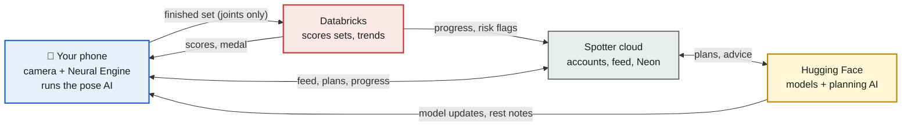

| Part | What it does | Built with |
|---|---|---|
| Phone app | Films the set, runs pose AI on the neural processor, counts reps, shows the skeleton, rest notes, plans and feed | React Native + Expo dev build, `react-native-vision-camera`, YOLOv8n-pose (Core ML on iPhone) |
| Spotter cloud | Accounts, sessions, social, planner, sync | Node + Express + TypeScript, Neon Postgres |
| Databricks | Set scoring, medallion pipeline, risk model, dashboards, retraining | Free Edition: Lakeflow, MLflow, Model Serving, AI/BI, Genie |
| Hugging Face | Model hosting, LLM, embeddings, moderation, GPU re-check | Hub, Inference Providers, Inference Endpoint or Space |

---

## 4. AI on the phone

The phone's neural processor (Apple's Neural Engine on iPhone) runs the pose model. That means nothing extra to buy or carry, no Wi-Fi pairing, and no video ever leaving the device.

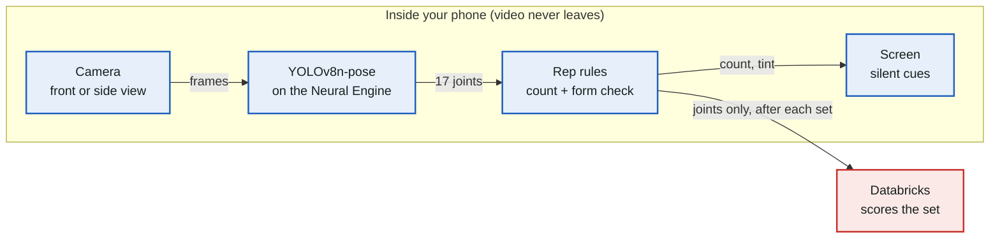

| Item | Choice | Why |
|---|---|---|
| Pose model | **YOLOv8n-pose**, exported with `yolo export model=yolov8n-pose.pt format=coreml` | 17 COCO joints, nano size suits a phone's neural processor, and Ultralytics ships a workout-monitoring example to start from. **Measure fps on your own phones early.** |
| License | AGPL-3.0 | The repo has to be public. That's normal for a hackathon; a commercial version would need an Ultralytics enterprise license or a switch to MediaPipe or MoveNet (both Apache-2.0). |
| App integration | Expo **development build** (not Expo Go) + `react-native-vision-camera` v4 | A small native frame-processor plugin runs the Core ML model on each frame and returns joints to JavaScript |
| Camera placement | One camera, on a small tripod or propped up, 2–3 m away; side-on for squats and lunges | One fixed angle keeps the rules simple. An on-screen framing guide helps users place it. |
| Smoothing | One Euro filter per joint | Removes jitter without adding lag |
| Android (stretch) | No on-device pose. Every frame goes through cloud mode ([§4.1](#41-pose-modes-on-device-cloud-and-basic), CONN-11) | Same joints, same rules, one model to maintain |
| Browser demo (fallback) | ONNX Runtime Web on WebGPU | Slower, but runs on a laptop if a phone build breaks |
| Model updates | The app checks our Hub repo on launch and downloads a newer model if there is one | Closes the retraining loop in [§5](#5-phone-databricks-and-hugging-face-inference-split) |
| Battery and heat | Run at 15–30 fps and pause inference during rest | Keeps a long workout from draining the phone |

### 4.1 Pose modes: on-device, cloud and basic

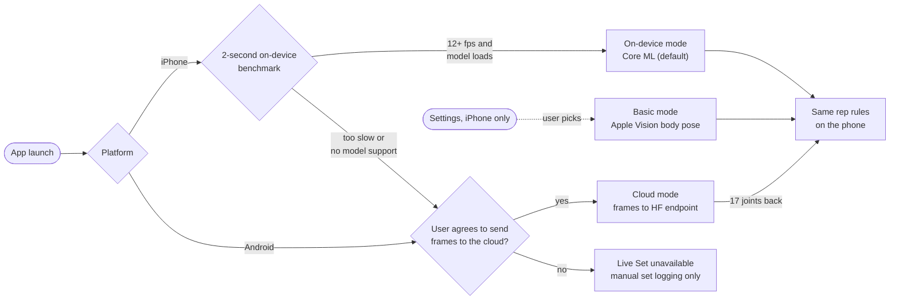

- **iPhone:** on first launch the app runs YOLOv8n-pose for two seconds. If it holds about 12 fps and the model loads, it uses on-device mode (`coreml`), the default. Otherwise it offers cloud mode.
- **Benchmark (AI-04):** runs silently at app start, on a synthetic frame. It needs no camera permission or person in frame.
  - **Timing:** the first inference is discarded, because the model is still loading onto the Neural Engine. Then 0.5 s of warm-up is discarded and 1.5 s is measured.
  - **Pass mark:** sustained fps is 1000 ÷ p95 latency, so slow frames count. The bar is 12 fps.
  - **Sizes:** if 320 px falls short, it retries at 256 px (§18), and the live detector uses whichever size passed.
  - **Caching:** the result is cached on the phone (MMKV) and re-runs only when the bundled model changes (new export or Hub download) or the user re-runs it from settings.
  - **Before it finishes:** the mode is `pending`, unless the user picked basic mode, which doesn't need the benchmark.
- **Android:** always cloud mode. Android runs no pose model on the phone.
- **Consent:** cloud mode needs explicit one-time consent. If the user declines, Live Set is unavailable on that phone; manual set logging still works.
- **Manual choices:** on iPhone the user can switch from on-device to cloud in settings (still needs consent), or pick basic mode.
- **How:** the phone sends downscaled JPEG frames (about 320 px, 10 fps) over a WebSocket to a **Hugging Face Inference Endpoint** on a small GPU, running YOLOv8n-pose (or the larger `yolov8m-pose`) with a custom handler. The endpoint returns only the 17 joints per frame, and the phone runs the same rep rules and silent cues as on-device mode.
- **Speed:** a round trip of roughly 150–300 ms on good signal (estimate; measure it). That's fine here because nothing is spoken mid-rep, so a small delay on the rep counter isn't noticeable. On weak gym signal, the app drops to fewer frames per second.
- **Lost connection:** if the endpoint is unreachable mid-workout, tracking pauses with a quiet "reconnecting" state, and the user can enter reps for that set by hand. If the phone also passed the on-device benchmark (the user chose cloud manually), the app falls back to on-device `coreml` instead of pausing.
- **Privacy:** this is the only mode where video leaves the phone, so it needs the explicit consent above. Frames are processed in memory on the endpoint and never stored.
- **Cost:** endpoints are billed while running, from the team's HF credits. Set scale-to-zero so it only costs money while someone is mid-workout. A Gradio Space is not a good fit here, because it queues requests instead of streaming.
- **Basic mode (iPhone, manual only):** Apple Vision body pose (`VNDetectHumanBodyPoseRequest`, source `vision`) runs fully on-device. The user picks it in settings, e.g. "Basic, on-device"; it is never chosen automatically. It maps Vision's 19 points to the same 17 COCO joints (neck and root dropped). It's less accurate but enough for rep counting and the main form rules.
- **Code:** the selection logic is a pure function, `selectPoseMode` in `apps/mobile/src/pose/mode.ts`, returning `'coreml' | 'vision' | 'cloud' | 'paused' | 'unavailable'`. The benchmark is `benchmark.ts`, and `usePoseMode.ts` caches its result with the user's preference and cloud consent and feeds them to `selectPoseMode`. It also exposes `needsCloudConsent` for the consent prompt (FE-15) and `rerunBenchmark` for settings. The native side is `benchmarkPoseModel` in `modules/spotter-pose`. The Apple Vision detector is `apps/mobile/src/pose/basic.ts` plus the native `HybridBasicPoseDetector` in `modules/spotter-pose`; the joint mapping is `VisionPoseMapper.swift` in PoseCore.

---

## 5. Phone, Databricks and Hugging Face inference split

Each platform gets the job that matches its speed. **The phone** runs YOLOv8n-pose and the rep rules on its Neural Engine, because only on-device AI can react within a tenth of a second. When a set ends, the phone sends that set's joint positions (never video) to a **Databricks** Model Serving endpoint running our MLflow form-quality model. It scores every rep and picks the set's medal in about a second, while the rest timer is still running, and the same data lands in the bronze, silver and gold tables. **Hugging Face** handles the heavy and language work. Our YOLOv8 and form models live on the Hub, and the app downloads new versions from there. A larger pose model on an HF GPU endpoint can re-check a flagged set. gpt-oss on Inference Providers turns the scores into the one-line rest note and the weekly plan. The loop closes when Databricks retrains on new sessions and publishes the improved model to the Hub for every phone to download.

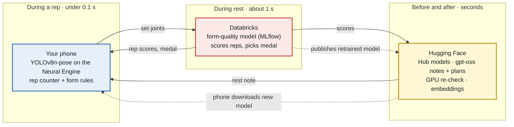

| Job | Runs on | Model | Fallback if it's slow or down |
|---|---|---|---|
| Joint detection | Phone neural processor (iPhone); HF Inference Endpoint in cloud mode (Android, slow iPhones) | YOLOv8n-pose (ours, optionally fine-tuned) | Lower input size or frame rate; cloud mode with consent |
| Rep counting, live form tint | Phone | Rule engine (JSON specs) | n/a, always local |
| Per-rep quality score and label (advice) | Databricks Model Serving (CPU) | Small GRU or gradient-boosted model on rep features, registered in Unity Catalog via MLflow | Skipped: the set medal comes from the phone's rule flags either way (§8) |
| Deep re-check of a flagged set (optional) | HF Inference Endpoint or Gradio Space (GPU) | Larger pose model run on the set's joints and rep features | Skip; use the phone result |
| Rest note, weekly plan, advice answer | HF Inference Providers | `openai/gpt-oss-120b` (fallback `gpt-oss-20b`) | Template sentence from the scores |
| Retraining | Databricks jobs + MLflow | Form-quality model and optional YOLOv8 fine-tune | Ship the last good model |

**Caveats to plan around:**
- Databricks Free Edition Model Serving is CPU-only with a capped number of endpoints, so keep the scoring model small. If serving isn't available, run scoring as a job per session; the phone's score covers the rest timer.
- HF Inference Providers serve hosted LLMs, not custom models. A custom re-check model needs a paid Inference Endpoint (from the team's HF credits) or a Gradio Space with an API. Because video stays on the phone, the cloud re-check works from joints, not frames.
- Keep a single source of truth: Databricks registers each model in MLflow, then a job pushes the Core ML and ONNX exports to the Hub repo.

---

## 6. Rep counting and form engine

Each exercise is a **JSON spec**: which angles to compute, the rep phases, and the form rules. AI engineers can add exercises without touching code, and injury mode tightens limits per user. The rules run in TypeScript inside the app. Rules produce silent flags; the words come later (see [§7](#7-quiet-coaching)).

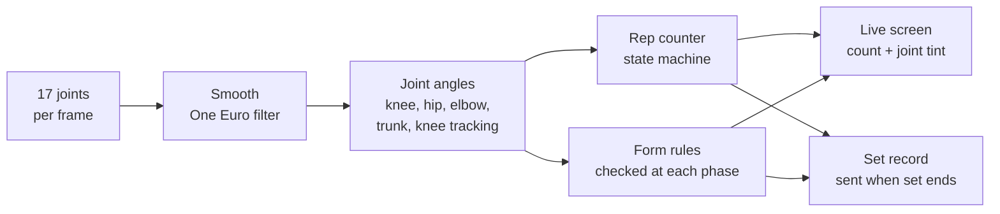

### 6.1 Rep state machine (squat example)

Hysteresis and minimum time in each state stop jitter from double-counting. Every exercise uses the same four states, `start → outbound → peak → return`, driven by its primary angle. The squat names them Standing, Lowering, Bottom and Rising. The shoulder press runs the other way (`direction: "increasing"`, so the elbow angle rises), with the same states.

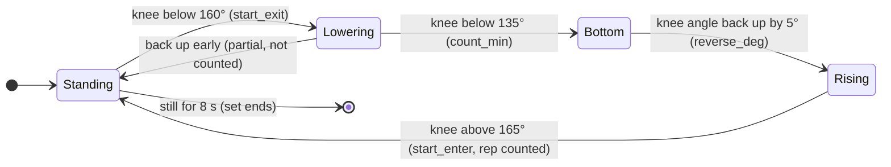

- **The depth target (95°) is a form rule, not a counting condition.** A rep that passes `count_min` but stops short of the target is counted *and* flagged, so the lifter sees the rep and gets a note about range.
- A state change is accepted only after `min_state_ms` in the current state.
- **Only real movement counts:**
  - **Gate:** a spec can require a position for the rep to reach its peak (`primary_angle.gate`). For the shoulder press, that's the wrists above the shoulders, so arms hanging straight never read as a lockout.
  - **Unreliable frames:** frames where the primary angle's joints are low-confidence, or where the angle jumps impossibly fast, don't move the counter.
- The rep is counted on crossing 165°, but the frames its form rules look at run until the lifter settles at the top, so a lockout check sees the full extension.
- **Engine (AI-06):** the engine lives in `apps/mobile/src/engine/`.
  - **Pipeline:** One Euro smoothing per joint, then the spec's metrics, measured with x scaled by the image aspect ratio, because joints are normalised per axis. Then this state machine runs on the primary angle.
  - **Output:** it emits `rep_counted` at the crossing, and `rep_closed` with the rep's frame windows once the rep settles. The form rules (AI-07) use those windows.
  - **Hook:** `useFormEngine` is what the live screen uses.
- **Missing data:**
  - A joint below confidence 0.3 keeps its last position for 300 ms, then counts as missing.
  - Metrics that need a missing joint are empty for that frame.
  - A frame with no person, or without the primary angle, freezes the counter. Its time doesn't count toward `min_state_ms`, and it's left out of the rule windows.
  - `most_visible` sticks to one side during a rep.
- **Set end:**
  - **Still:** the lifter has been still (within 10°) for 8 s, in any position.
  - **Absent:** no person for 8 s.
  - **Lost:** a person is in view but the primary angle can't be measured for 8 s (for example, the ankles are cropped out).
  - **Manual:** a Done button.

  The still and absent ends only apply after the first counted rep, so setting up never ends a set. A rep cut off by the set end is a partial.

### 6.2 Example exercise spec

Specs live in `specs/exercises/<id>.json`: `squat`, `push_up`, `bicep_curl`, `shoulder_press`, `lunge`.

- **Shape:** `specs/exercises/schema.json`.
- **Validation:** `node specs/validate.mjs` checks the shape, references, threshold order (with every injury override applied) and the tone of every note.
- **Full format:** [docs/specs/exercise-spec-format.md](docs/specs/exercise-spec-format.md).

Each rule has a `rest_note` that the LLM may rephrase. Notes describe the movement, never the person, and never give commands. Shortened squat spec:

```json
{
  "id": "squat",
  "recommended_view": "side",
  "angles": {
    "knee":  { "type": "joint_angle", "joints": ["hip", "knee", "ankle"], "side": "most_visible" },
    "trunk": { "type": "segment_tilt", "from": "mid_hip", "to": "mid_shoulder" },
    "knee_width_ratio": { "type": "width_ratio", "numerator": ["left_knee", "right_knee"],
                          "denominator": ["left_ankle", "right_ankle"] }
  },
  "primary_angle": { "name": "knee", "direction": "decreasing" },
  "phases": { "start_exit": 160, "count_min": 135, "target": 95, "start_enter": 165,
              "reverse_deg": 5, "min_state_ms": 150, "set_end_still_ms": 8000 },
  "rules": [
    { "id": "depth", "phase": "peak", "view": "side",
      "check": { "metric": "knee", "reduce": "min", "op": "<=", "value": "target" },
      "severity": "form", "priority": 1, "label": "partial_range",
      "joints": ["left_hip", "right_hip", "left_knee", "right_knee"],
      "rest_note": "Next set, try lowering until your hips are level with your knees." },
    { "id": "knee_tracking", "phase": "rep", "view": "front",
      "check": { "metric": "knee_width_ratio", "reduce": "min", "op": ">=", "value": 0.9 },
      "severity": "form", "priority": 2, "label": "knees_in", "joints": ["left_knee", "right_knee"],
      "rest_note": "Your knees drifted inward on {n} reps. Pointing them over your toes keeps them comfortable." },
    { "id": "trunk_lean", "phase": "peak", "view": "side",
      "check": { "metric": "trunk", "reduce": "max", "op": "<=", "value": 45 },
      "severity": "form", "priority": 3, "label": "forward_lean",
      "joints": ["left_shoulder", "right_shoulder", "left_hip", "right_hip"],
      "rest_note": "Keeping your chest a little taller makes this easier on your back." },
    { "id": "tempo", "phase": "outbound", "view": "any",
      "check": { "metric": "duration_ms", "op": ">=", "value": 800 },
      "severity": "form", "priority": 4, "label": "fast_lowering",
      "joints": ["left_hip", "right_hip", "left_knee", "right_knee"],
      "rest_note": "Your reps took about {t} s on the way down. Around 2 s gives you more control." }
  ],
  "injury_overrides": {
    "knee": { "phases": { "target": 110 }, "rules": { "tempo": { "value": 1500 } },
              "extra_note": "The depth here is set shorter to suit a recovering knee. Any pain is worth raising with your physio or a doctor." },
    "shoulder":   { "extra_note": "..." },
    "lower_back": { "phases": { "target": 105 }, "rules": { "trunk_lean": { "value": 35, "severity": "safety" } },
                    "extra_note": "..." }
  }
}
```

- **Checks are structured, not expressions.** A rule passes when `metric` (reduced over the rule's `phase` with `min`, `max`, `mean`, `first` or `last`) meets `op value`. Otherwise it flags that rep. `value` can name a threshold (`"target"`), so an injury override's phase changes carry through to the rules.
- **`view`** is `front`, `side` or `any`. Rules that need a particular camera angle are skipped when the lifter is filmed from the other one, so a side-on squat never raises knee-tracking flags, and a front-on one never gets a depth flag from a knee angle foreshortened by the camera.
- **`severity`, `priority`, `label` and `joints`:**
  - `severity`: `safety` is the only one that may use the optional haptic.
  - `priority`: picks the one note shown during rest.
  - `label`: the §6.3 model label.
  - `joints`: what tints amber on the skeleton.
- **Form rules (AI-07):** `apps/mobile/src/engine/rules.ts` checks each rep when it settles and returns its flags and the joints to tint. Flags are held until the set ends, then released as one set summary: the flags, per-rule counts, and the top rule for the rest note.
  - **View:** detected per rep from shoulder and hip width against torso length. When it's unclear, only `any` rules run.
  - **Skipped rules:** a rule whose metric is missing in over half its frames is skipped for that rep, not flagged.
  - **`duration_ms`:** measured with the deepest point as the turn, so tempo covers the whole way down.
  - Full behaviour: [form rules design](docs/superpowers/specs/2026-10-10-form-rules-design.md).
- **Injury overrides:** every spec has `knee`, `shoulder` and `lower_back`. An override can change thresholds, patch a rule's value, severity or note, and disable rules. Every override has an `extra_note`. These are fixed per body part. With several injuries, they apply in that order and the more conservative value wins (`applyInjuries`, the same merge on the phone and in `specs/validate.mjs`). A physio's own limits (`REHAB_LIMIT`) are applied per user, on top.

### 6.3 Form-quality model and our dataset (Hugging Face + Databricks)

- **Input:** one rep's joints, normalised and resampled to 32 frames × 17 joints × 2.
- **Model:** a small GRU, or gradient-boosted trees on rep features (range, tempo, symmetry, knee tracking). Output: quality 0–1 plus a label: `clean`, or one of the rule labels in the specs (`partial_range`, `knees_in`, `forward_lean`, `fast_lowering`, `hip_sag`, `incomplete_lockout`, `elbow_drift`, `torso_swing`, `back_arch`, `wrists_off_stack`).
- **Data:**
  1. Bootstrap with public landmark data such as `Cuong2004/gym-exercise-landmarks` (check its license; convert MediaPipe 33-point data to the 17 COCO joints).
  2. **Record and label our own clips at the hackathon**: teammates doing deliberate clean and off-form reps, filmed on a phone.
  3. Keep only joints, then publish to the Hub as a dataset with a card. No clean public dataset of form-error labels exists on the Hub today, which makes this a genuine contribution.
- **Train and serve in Databricks** (MLflow tracking, Unity Catalog registry, Model Serving). **Publish to the Hub** (ONNX plus model card) with a **Gradio Space** where judges upload a clip and see per-rep scores.

---

## 7. Quiet coaching

Beginners and people coming back from injury are often self-conscious in the gym. A voice correcting them while they lift would push them out the door. **Spotter never speaks or pops up during a rep.**

| When | What the lifter sees | What the system does |
|---|---|---|
| **During the set** | Rep counter ticks up. Joints on the skeleton tint amber if form drifts. No sound, no pop-ups. | The phone scores each rep in under 0.1 s. Flags are held until the set ends. An optional haptic tap is reserved for safety issues only, and is off by default. |
| **Rest** | One short note, good news first. Example: *"Steady tempo on all 8. Next set, try lowering to knee height."* | Databricks scores the whole set. gpt-oss writes the note from the scores and the rule's `rest_note`. |
| **After the workout** | Medal (bronze, silver or gold), a short summary, optional post to the feed | Session saved as joints only. Trends update in Databricks. |

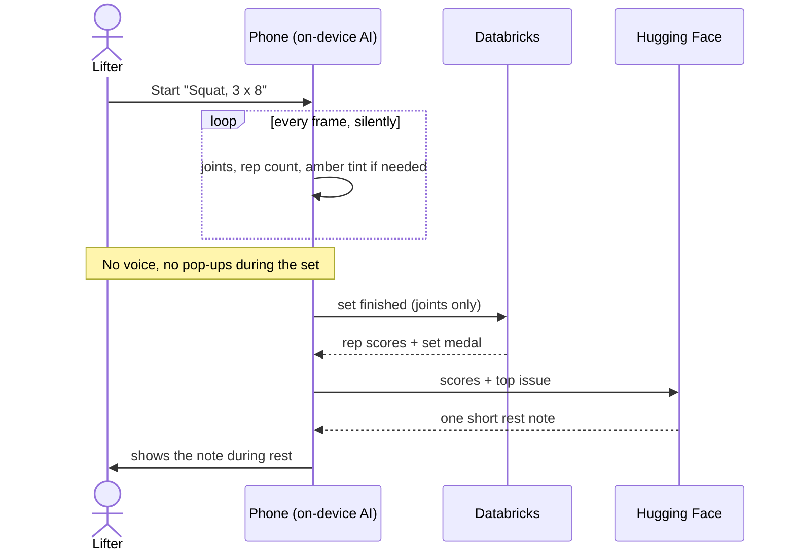

**How messages are phrased**

| What happened | Spotter says, during rest | Why it's phrased this way |
|---|---|---|
| Reps stopped short of full range | "Next set, try lowering until your hips are level with your knees." | Describes the movement, not the person |
| Knees drifted inward | "Your knees drifted inward on the last 2 reps. Pointing them over your toes keeps them comfortable." | Facts and a reason, no commands |
| Lowering too fast | "Your reps took about 1 s on the way down. Around 2 s gives you more control." | Numbers over adjectives |
| Some reps weren't clean | "6 of 8 reps were clean. Nice work." | Good news first; never "bad" or "wrong" |
| Several issues in one set | Only the most important one | Easy to act on |

The LLM prompt includes these rules, and its output is checked against the banned commanding phrases and imperative sentence openers in `specs/banned-phrases.json` before it's shown (the fixed notes in the specs pass the same check); if it fails, the rule's fixed `rest_note` is shown instead. Sound is off by default. Users who want audio can enable earbud-only notes, which play only during rest.

---

## 8. Workout medals

The Databricks pipeline layers and the lifter's medals share names: raw data becomes more refined at each stage, and so does the workout.

Every workout gets a **form score**: the share of reps that were clean, judged against the person's own limits. The medal compares that score with **the lifter's own average over the last four weeks**, so people are measured against themselves, not against other lifters. A first workout is compared with a beginner baseline of 70%.

**What counts as clean.** A rep is clean when the phone raised no rule flags for it. The rules run with the lifter's injury overrides and physio limits applied, so clean means "within your own limits". The rules decide; the Databricks form-quality model only advises. Its per-rep quality and label are stored, shown and used for the dashboard and retraining, but never decide clean, the form score or a medal. That keeps every medal explainable (each rep that isn't clean has a named rule), consistent with the amber tint the lifter saw mid-set, and true to their physio's limits. The API, the pipeline and the rest card all use this one definition, and shared fixtures (`specs/set-record/fixtures/medals/`) check that they agree.

| Medal | Earned when | Feed post |
|---|---|---|
| **Bronze workout** | The workout was finished, with a form score below the lifter's average. Showing up counts. | Optional |
| **Silver workout** | The form score matched or beat the lifter's own average. A solid, typical day. | Optional |
| **Gold workout** | Every rep of every exercise was clean | Optional: "Finished a gold-level workout" |

- "Clean" uses each person's own limits, so someone with a knee injury who keeps to their adjusted range can still earn gold.
- As a lifter improves, their average rises, so silver keeps meaning "your normal" rather than getting easier over time.
- Each set gets its own medal during the rest, by the same rules against the lifter's average; the rest card labels it as that set's medal. The workout medal is computed by the API when the session finishes (`services/medals.ts`), and the pipeline's `gold_workout_medals` follows the same rules.
- Medals feed streaks and goals ("3 gold workouts this month") and appear on profiles.

---

## 9. Backend and Neon data model

**Stack:** Node.js + Express + TypeScript (Neon Postgres, Express, React Native, Node). **Neon serverless Postgres** via `@neondatabase/serverless`, with Drizzle ORM.

### 9.1 How we use Neon

| Neon feature | Use in Spotter |
|---|---|
| **Neon Auth** | Sign-up and login. The API verifies JWTs. Free for up to 60k monthly active users. |
| **Postgres** | Users, injuries, plans, sessions, sets, reps, medals, PRs, goals, the social graph, advice threads |
| **pgvector** (HNSW) | RAG over exercises and injury notes, buddy matching on profile embeddings, similar advice questions |
| **Branching** | One branch per developer plus a `demo` branch seeded with realistic data, reset before judging |
| **Serving store for Databricks** | Gold-table insights are synced into Neon, so the app never waits on a cold warehouse |
| **Data API** (optional) | Read-only progress views for the app with RLS; confirm it's on the free plan first |
| **Scale to zero** | Costs nothing between sessions. Warm it up before the demo. |

Frame-by-frame joint data is **not** stored in Neon. It goes straight to a Databricks Volume, keeping Neon inside the 1 GB free tier.

### 9.2 Data model, in four groups

**Workouts**

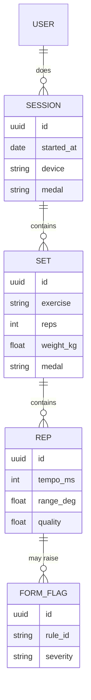

**Planning**

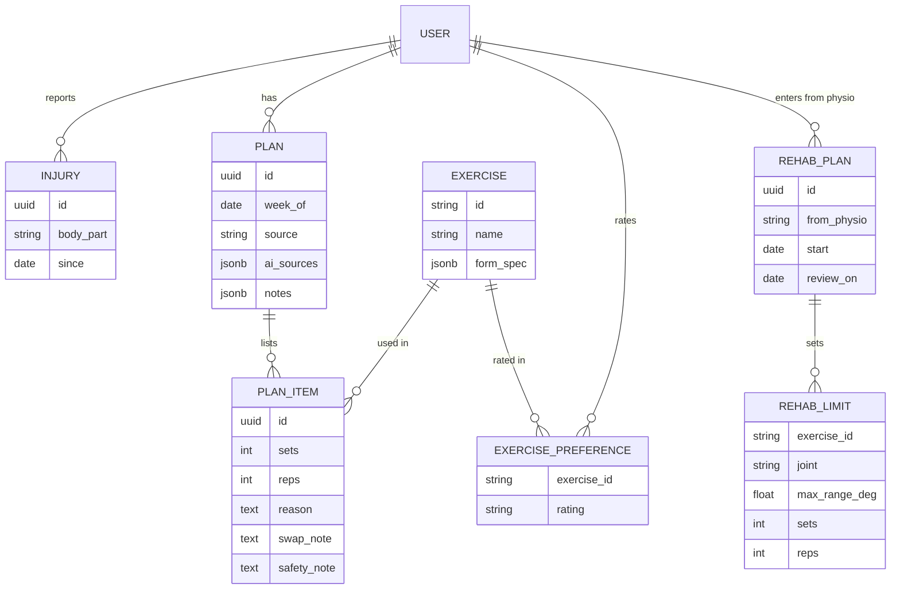

**Social**

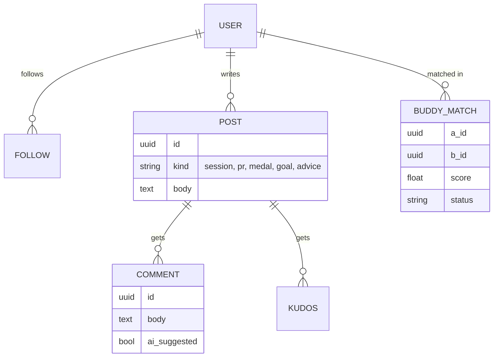

**Progress**

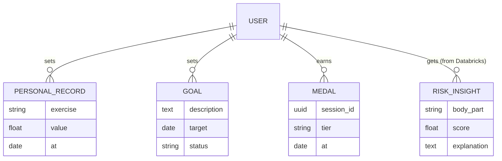

`USER` carries `handle`, `experience_level`, `gym_place_id`, `schedule` and a 384-dimension `embedding` for buddy matching. `DOC_CHUNK (source, content, embedding)` holds the RAG text.

### 9.3 API surface (MVP)

| Method and path | Purpose |
|---|---|
| `POST /sessions` · `POST /sessions/:id/sets` · `POST /sessions/:id/finish` | Session lifecycle. Finishing computes the medal and PRs and queues the Databricks export. |
| `GET /sets/:id/rest-note` | Rest note for the last set |
| `GET /me/progress` · `GET /me/insights` | Progress and risk insights (read from Neon) |
| `POST /plans/generate` · `GET /plans/current` | Planner (see [§10](#10-workout-planner-and-advice)) |
| `PUT /me/exercise-preferences/:exerciseId` · `GET /me/exercise-preferences` | Thumbs up/down on an exercise, from any screen; feeds the planner |
| `GET /feed` · `POST /posts` · `POST /posts/:id/kudos` · `POST /posts/:id/comments` | Social |
| `POST /advice` | Ask the community; an AI-suggested first answer is attached |
| `GET /buddies/suggestions` · `POST /buddies/:id/request` | Buddy matching |
| `GET /exercises` · `GET /exercises/:id/spec` | Exercise library and form specs |

---

## 10. Workout planner and advice

All LLM, embedding and moderation calls go through **HF Inference Providers** with one token (`@huggingface/inference`, or the OpenAI-compatible base URL `https://router.huggingface.co/v1`). Budget: $20 of credits per person.

| Job | Model (Hub ID) |
|---|---|
| Plans, rest notes, advice answers | `openai/gpt-oss-120b` (fallback `openai/gpt-oss-20b`), JSON-schema output. Test the model and provider pair early; `Qwen/Qwen3-32B` on Cerebras is HF's documented structured-output example. |
| Embeddings | `BAAI/bge-small-en-v1.5` (384 dimensions) |
| Reranking (optional) | `BAAI/bge-reranker-large` |
| Moderation | `meta-llama/Llama-Guard-4-12B` on posts, comments and advice |

### 10.1 Planner pipeline

The AI drafts the plan; plain code checks that it's safe.

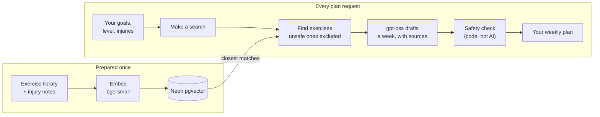

- **Sources:** [free-exercise-db](https://github.com/yuhonas/free-exercise-db) (800+ exercises, public domain) and short injury-modification notes written by the team (`rag/notes`). Each section names the pages that support it: public health bodies, national professional bodies and major academic medical centres only (NHS, MedlinePlus/NIH, AAOS OrthoInfo, ChoosePT, Cleveland Clinic, Harvard Health). Programming tips no such page states are marked as team guidance. A rewritten note stays out of the index until a person reviews it. Don't scrape ExRx.
- **Safety check:** drops anything contraindicated for a reported injury, caps weekly volume increases at 10%, puts compound and machine work first for beginners, and adds "check with your physio" notes. Every plan item stores the chunks it came from, so the app can show "why this exercise".
- **Exercises:** the five camera-tracked exercises come first. Library exercises can be planned too; they're added to `exercises` on first use without a form spec (`has_spec: false`), so the app shows them as logged by hand. A library exercise that loads an injured joint is filtered out in the vector search and again in code. A tracked exercise whose spec has an `injury_override` for that joint stays, with the spec's note, unless the injury is severe.
- **Looking back (temporal history):** the last six weeks, with recent weeks counting more (a set's weight halves every two weeks). Per exercise: sessions, sets and reps, clean share and its trend, medals, PRs, and whether it was done when planned. Plus the range-of-motion trend and how much of the last plan was done. These set each item's sets and reps (up when work is clean and medalled, down when form or range dips) and the weekly cap: total reps at most 10% over the last week with training.
- **Likes and dislikes (vector store):** thumbs up/down per exercise, plus habits from the same history (done often, completed rather than skipped, clean form). They give each exercise a score and, folded together, one taste vector per user in the exercise-embedding space (`exercise_taste`). Liked exercises rank higher, and the taste vector pulls similar library exercises up. A disliked one is swapped for a safe exercise of the same kind when there is one. Preferences only re-rank exercises that already passed the safety check.
- **Week and schedule:** a plan covers the current week from Monday in the user's time zone, on the days from their onboarding schedule, 3 to 5 exercises a day. Regenerating makes a new plan for the week, keeps the days already past, and leaves the old plan as history. Plans give sets and reps, not weights.
- **Without the LLM:** with no `HF_TOKEN`, or if gpt-oss fails or is slow, a rule-based plan is built from the same history, preferences, search and safety check (`source: "rules"`).
- **Rehab first:** while a rehab plan from a physio is active, `POST /plans/generate` returns 409. The physio's plan is the plan.

### 10.2 Advice questions

1. Moderate with Llama Guard.
2. Find similar answered questions with pgvector.
3. Draft a short, sourced answer with gpt-oss, labelled **"AI suggestion"**, posted as the first comment. Community answers follow.
4. Questions mentioning pain get a fixed "please see a medical professional" reply instead of an LLM answer.

**Answer writer (AI-13):** `apps/api/src/services/advice.ts`, called by BE-11 with the question and the sources it retrieved:
- **Pain:** following §1.1, a check in code returns the fixed reply for any pain word that isn't negated, and for acute signs (a pop or tear, swelling, numbness, can't bear weight, chest pain or dizziness, a fresh injury). The model never sees the question. Soreness, stiffness and tightness still get an answer, and so does a past or recovering injury with no pain or acute sign: training again after an injury is what Spotter is for.
- **Sources:** the question and up to 6 sources go to gpt-oss as data. The answer is at most 3 sentences and cites 1 to 3 of them by id.
- **Reputable sources only:** library sources reach the model only from the allow-listed sites above, plus free-exercise-db for technique. Team-guidance sections are never cited. Community answers can be cited and are labelled as community.
- **Guard:** the answer is shown only when every cited id was given, every number in it comes from a cited source, it passes the §7 tone check (no commands or banned phrases), and it names no condition, cause, medication or guaranteed outcome, and carries no links or promotions.
- **Claim check:** a second gpt-oss call checks each sentence against the text of the sources it cites. Any added fact, benefit or cause means no answer. Both calls share one time budget.
- **Disclaimer:** every AI answer ends with "This is general information, not medical advice. Always consult a doctor before acting on it." It is part of the answer text, so it shows wherever the answer does.
- **Fallback:** anything else (nothing to cite, a slow or failed model, a rejected answer) means no AI comment; community answers carry the thread.

---

## 11. Databricks analytics and ML pipeline

**Goal for judges:** session data flows into Databricks, is refined through bronze, silver and gold, powers live set scoring, dashboards and models, and **the results flow back into the app**.

**Free Edition constraints that shape the design:**

- Serverless only, one 2X-Small SQL warehouse, one active pipeline per type.
- Daily fair-use quota; going over stops compute for the day.
- Limited, CPU-only Model Serving.
- Zerobus Ingest has a known Free Edition failure ("Tables created in default storage are not supported"), so **we don't use Zerobus**.

### 11.1 Pipeline

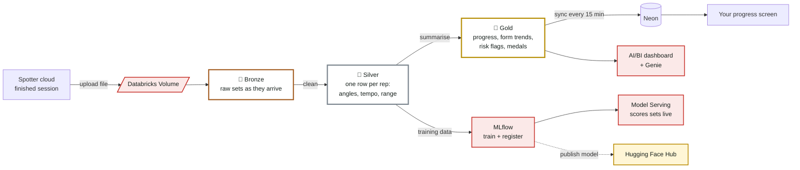

- **Ingest:** the API uploads each finished session as JSON metadata plus gzip'd joint arrays to a Unity Catalog Volume through the Files API (`PUT /api/2.0/fs/files/Volumes/...`). Auto Loader in a Lakeflow Declarative Pipeline picks it up. Small rows can go in directly with the Statement Execution API.
- **Live set scoring** goes from the phone through the API to the Model Serving endpoint (see [§5](#5-phone-databricks-and-hugging-face-inference-split)); the session upload happens afterwards.

| Layer | Table | Key columns |
|---|---|---|
| Bronze | `bronze_sessions` | session_id, pseudonymous user_id, device, inference mode, exercise, raw joints, reps, flags, ingest time |
| Silver | `silver_reps` | rep_id, exercise, range, tempo (lowering/rising), left/right symmetry, flags, quality |
| Silver | `silver_frames` | rep_id, time, joint angles |
| Gold | `gold_user_progress_daily` | user, date, exercise, reps, average range and quality, estimated PR |
| Gold | `gold_form_summary` | exercise, rule, flag rate by experience level and injury group |
| Gold | `gold_workout_medals` | session, medal tier, clean-rep share |
| Gold | `gold_rom_trend` | user, joint, side, week, peak range, change vs injured-side baseline and healthy side |
| Gold | `gold_training_features` | 32-frame rep windows plus labels |
| Gold | `gold_injury_risk_scores` | user, body part, date, 7- and 28-day features, `range_side` (`injured` or `min`), heuristic score, top contributing features, `weak_label` |
| Gold | `gold_injury_risk_model_scores` | user, body part, date (latest per lifter and body part), model score, top contributing features, `model_version` (champion run id), `scored_at` |
| Gold | `gold_risk_feature_importance` | `model_version`, feature, family, gain, rank, `trained_at` |
| Gold | `gold_risk_model_metrics` | predictor (`model` or `heuristic`), ROC-AUC, PR-AUC, Brier, `model_version`, test positives and rows |

The last three are written by the `risk_model` notebook ([§11.2](#112-injury-risk-model)), not the pipeline. Every injury-risk table carries the comment "Not a diagnosis".

### 11.2 Injury-risk model

This is a **training-load and form-trend score, not a diagnosis.** Example features over 7 and 28 days:

- Rising rate of knee-tracking flags.
- Shrinking range on the injured side.
- Left/right asymmetry above 15%.
- Acute-to-chronic volume ratio above 1.5.
- Tempo speeding up under fatigue.

**Range side:** range uses the injured side when `silver_reps` knows it, and the smaller of left and right otherwise. The side is resolved once per lifter and body part, from the latest session that names it, so the 7- and 28-day windows never mix sides. `range_side` records which was used. The heuristic and the model share this one definition.

**Heuristic score and weak label (pipeline, `gold_injury_risk_scores`):** a weighted sum of the five families above (`flag_rate_rising` 0.30; `range_shrinking`, `asymmetry` and `acute_chronic_load` 0.20 each; `tempo_speeding_up` 0.10), with `weak_label = score >= 0.5`. At hackathon scale there are no real injury labels, so **the labels are heuristic.** Tell judges so.

**Model (`databricks/notebooks/risk_model.py`, a daily job after the pipeline):**

- **Label = a forecast.** For each lifter, body part and day D, the label is whether the heuristic flag is raised on any tracked day in (D, D+7]. Rows without 7 days of later data are scored but not trained on. A same-day label would only teach the model the rule it's computed from.
- **Features:** the 7- and 28-day columns plus their changes, grouped into the same five families the app explains, and a one-hot body part. Missing values stay missing (XGBoost handles them).
- **Training:** XGBoost with `scale_pos_weight` for the class imbalance. Train and test are split by lifter, so no lifter is in both. Scores are corrected back to the real class prior, so they read as probabilities.
- **Evaluation:** ROC-AUC, PR-AUC and Brier on the held-out lifters, for the model **and for the heuristic's own score used as next week's predictor**, so the model's value over the rule is measured, not assumed. If either split has only one class, training is skipped, the existing champion still scores, and the job fails so it shows up.
- **MLflow:** each run logs params, both sets of metrics, the class balance, the importance tables and the input dataset to the experiment `/Users/<owner>/spotter_injury_risk`. The model is a run artifact (`runs:/<run_id>/model`). The **champion** is the run tagged `champion=true`; a new run takes the tag only if its test PR-AUC is at least the champion's.
- **Unity Catalog:** registering `spotter.ml.injury_risk` is opt-in (`register_uc` widget, off by default). On Free Edition the artifact upload to the catalog's default storage is denied, so a failed attempt tags the run `uc_registration=skipped` and deletes the half-made version. When registration works, the `champion` alias follows the champion run.
- **Outputs**, overwritten each run from the champion:
  - `gold_injury_risk_model_scores`: each lifter and body part's latest day, with `top_features` = up to 3 families whose XGBoost contribution is at least 0.01, largest first.
  - `gold_risk_feature_importance`: gain per feature and family.
  - `gold_risk_model_metrics`: model vs heuristic test metrics.

**In the app:** the Neon sync reads the model scores first. It falls back to the heuristic table when the model table is missing, empty, unreadable or more than 36 hours old ([§11.3](#113-getting-insights-back-to-the-app)). Both tables have the same columns and family names, so `explainRisk()` and the "not a diagnosis" disclaimer work for either. Neon doesn't record which source a score came from.

**Dashboard:** the AI/BI dashboard "Spotter: injury-risk trends" (`databricks/dashboards/injury_risk.lvdash.json`) shows:
- feature importance by family
- held-out model vs heuristic metrics
- the model score distribution by body part (latest day)
- the share of lifters with a heuristic score of at least 0.5 per week, from the heuristic history, since the model table holds only the latest day
- a "not a diagnosis" note

**Demo data:** a notebook generates synthetic users × 6 weeks of sessions with realistic progressions and injury patterns.
- Besides the three recovery users, 30% of the others get a side-tagged injury.
- Half of those train through it: from week 3 or 4 their load jumps, and over two weeks the injured side loses range, the lowering speeds up and more reps are flagged, so most of them cross the heuristic flag.
- The training run used `data/synthetic-training-ids.json`: the 30 demo accounts plus 70 training-only ids.

Real sessions recorded at the hackathon are layered on top.

### 11.3 Getting insights back to the app

- **Default:** a Node cron reads the `gold_*` tables with `@databricks/sql` every 15 minutes and upserts into Neon. The app reads only Neon, so it's immune to warehouse cold starts and quota limits.
- **Genie:** in the demo, ask plain-English questions like "which exercises have the most knee-tracking flags among beginners?"

---

## 12. Social platform

Strava for people getting back on their feet: share sessions, recovery milestones, PRs and medals, set public goals, ask for advice, and find **recovery buddies** coming back from a similar injury, or gym buddies at your level.

- **Activity feed:** auto-generated cards for finished sessions, PRs and gold workouts, with kudos and comments. Posting is always opt-in.
- **Goals:** public goals with progress bars computed from sessions ("3 gold workouts this month"). Followers get nudges.
- **Advice:** ask the community, with an AI-suggested first answer ([§10.2](#102-advice-questions)).
- **Gym buddies:** matched by gym, experience level, schedule overlap and goals.
- **Safety:** Llama Guard moderation, block/report, and only coarse location (the gym, never live location).

**Buddy matching**

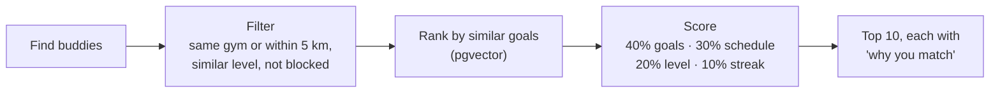

**Feed:** at hackathon scale, build the feed on read: posts from followed users plus same-gym beginners, newest first, with a keyset cursor.

---

## 13. Privacy and video lifecycle

**Rule: we keep pose, not people.** Video is processed on the phone and never uploaded, except for clips a user explicitly donates for training.

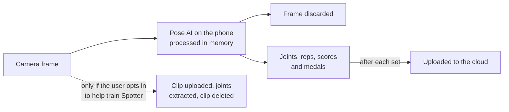

- **Pseudonymous IDs** in Databricks, never email or handle.
- **Injury data** is private by default and only used for buddy matching if the user opts in.
- **No medical claims.** Every injury-related screen shows a disclaimer, and anything built from the injury notes (AI advice answers, the planner's sources) carries "always consult a doctor" (`ADVICE_DISCLAIMER` in `apps/api/src/services/advice.ts`).
- **Account deletion** cascades in Neon and queues a delete job in Databricks.

---

## 14. Deployment

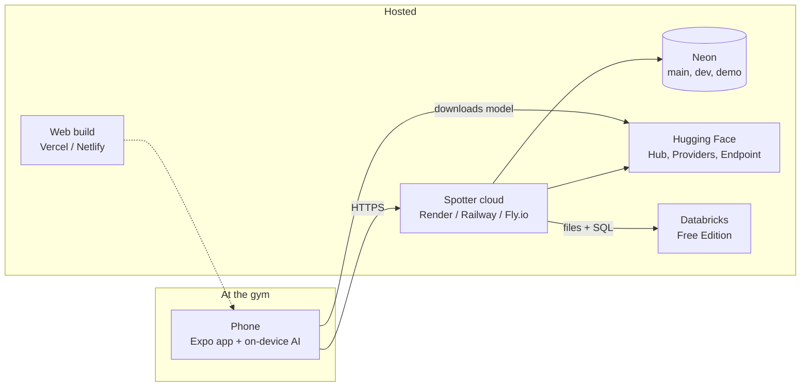

**Secrets:** the API holds the Neon URL, HF token and Databricks token in environment variables. The phone holds only the user's login token; it reaches Databricks and Hugging Face through the API. Never commit `.env`.

---

## 15. Repository layout

```
spotter/
├── apps/
│   ├── mobile/                # React Native + Expo (web + iOS)
│   │   ├── src/screens/       # LiveSet, Planner, Feed, Buddies, Progress
│   │   ├── src/pose/          # vision-camera frame processor + Core ML YOLOv8n-pose
│   │   └── src/engine/        # TS interpreter for exercise specs
│   └── api/                   # Express + TypeScript
│       ├── src/routes/
│       ├── src/services/      # sessions, planner (RAG), social, matching, moderation
│       ├── src/integrations/  # neon, huggingface, databricks
│       └── drizzle/           # schema + migrations
├── specs/
│   ├── exercises/*.json       # declarative exercise + form-rule specs, schema.json
│   ├── banned-phrases.json    # rest-note tone check, shared with the LLM
│   └── validate.mjs           # node specs/validate.mjs
├── ml/
│   ├── labelling/             # record + label clips, extract landmarks
│   ├── form_classifier/       # train, export ONNX, push to Hub
│   ├── pose_export/           # YOLOv8n-pose to Core ML / ONNX, push to Hub
│   └── space/                 # Gradio Space
├── databricks/
│   ├── pipelines/             # Lakeflow Declarative Pipeline (bronze/silver/gold)
│   ├── notebooks/             # synthetic data, risk model, MLflow
│   └── dashboards/
├── rag/                       # ingest free-exercise-db + injury notes into pgvector
└── docs/Architecture.md
```

---

## 16. Team split and build schedule

| Role | Owns |
|---|---|
| **AI engineer A** (on-device vision) | YOLOv8n-pose Core ML export and benchmarking, vision-camera frame processor, form engine and specs, labelling tool |
| **AI engineer B** (models + data) | Form-quality model, Databricks pipeline and serving, risk model, dashboard, Hub publishing, RAG, planner, rest notes, moderation |
| **Front-end dev** | Expo app: live-set screen with skeleton and amber tint, rest-note card, medals, planner, feed, buddies, progress. Figma polish if there's time. |
| **Back-end dev** | Express API, Neon schema, Auth and branches, session ingest, Databricks export and insight sync, deployment |

The schedule assumes about 36 hours; shift the blocks if yours differs.

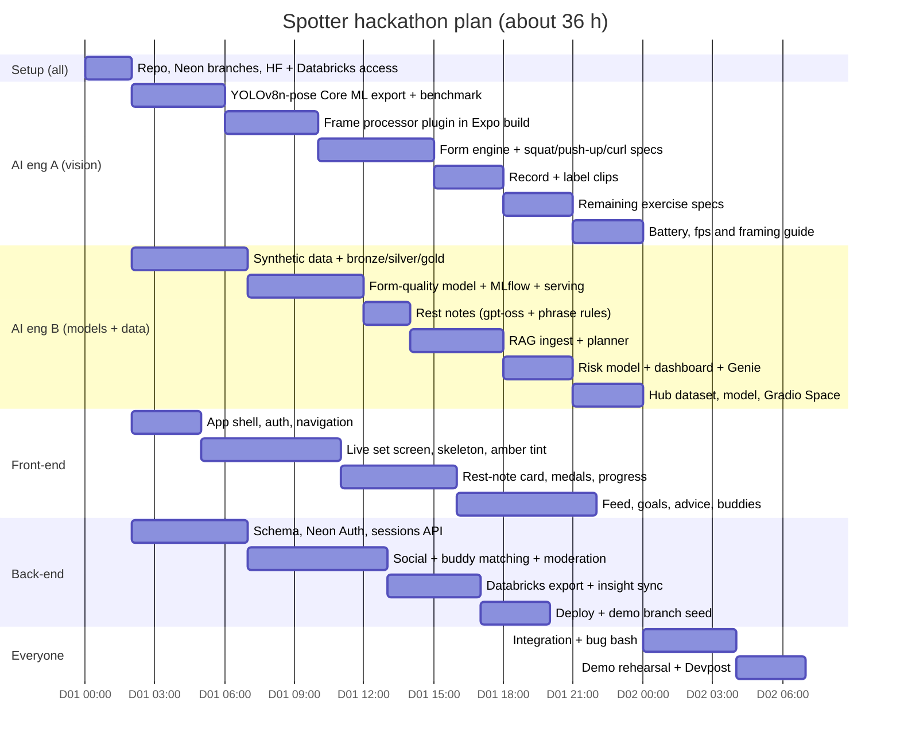

| Milestone | Target |
|---|---|
| Squat reps counted on the phone's neural processor, shown live in the app | Hour 12 |
| Rest note and set medal from Databricks + HF; first sessions in bronze | Hour 18 |
| Feed and buddies end to end; risk insights reach the app; model on the Hub | Hour 26 |
| Feature freeze; only fixes and demo prep after this | Hour 32 |

---

## 17. Demo script for judges

About 4 minutes, adjusted per judging room. Lead with that room's challenge.

1. **Hook (20 s):** "After an injury, you do your physio exercises alone at home with nobody checking your form, and it's easy to give up before you ever get back to the gym. Spotter is a quiet coach on the phone you already own."
2. **Live set (60 s):** a teammate squats with the phone propped up beside them. The rep counter climbs silently. One deliberate knees-in rep tints the knees amber, with no sound.
   - Turn on airplane mode mid-set to show the AI runs entirely on the phone. "17 joints per frame on the phone's own chip. Video never leaves the device."
3. **Rest (30 s):** the rest note appears: *"7 of 8 reps were clean. Your knees drifted inward on one rep; pointing them over your toes keeps them comfortable."* Show the set medal.
   - *Databricks:* "That score came from our MLflow model on Databricks Model Serving, in about a second." Show the pipeline, the MLflow run and the dashboard, then ask Genie one question.
4. **On-device proof (20 s):** show the live fps and latency readout from the phone's neural processor.
5. **Recovery (30 s):** open a demo user's physio plan and range-of-motion chart: "knee range up 18° in three weeks, now within 5° of the healthy side". Show the one-page physio report and a recovery-buddy match. The same squat set, judged against the physio's limits, earns gold.
6. **Plan (30 s):** generate a week. Show "why this exercise" sources and the lunge swapped for a glute bridge.
   - *Hugging Face:* "gpt-oss on Inference Providers, RAG with BGE embeddings, Llama Guard, and our own labelled form dataset and model on the Hub." Show the Space.
7. **Social (30 s):** "Finished a gold-level workout" posts to the feed; a buddy suggestion appears ("same gym, both beginners, both train mornings").
   - *Neon:* "Auth, the social graph, vectors and the serving layer for Databricks insights all live in Neon. We develop on branches and demo off a seeded branch."
8. **Close (10 s):** "Spotter: a quiet coach for every rep, and a community for every beginner."

---

## 18. Risks and fallbacks

| Risk | Likelihood | Fallback |
|---|---|---|
| YOLOv8n-pose too slow on older phones | Medium | Lower input to 256 px or the frame rate; then cloud mode (with consent). Apple Vision body pose is available manually on iPhone |
| Phone heats up or drains battery | Medium | Run at 15 fps and pause inference during rest |
| Frame-processor plugin is hard to build in Expo | Medium | Start it first; fall back to the browser demo with ONNX Runtime Web |
| Databricks serving unavailable or slow on Free Edition | Medium | The phone's rule score sets the medal; Databricks scores in a job afterwards |
| Databricks quota or cold warehouse during the demo | Medium | The app reads synced Neon tables only. Pre-run jobs before judging. |
| HF custom model hosting costs | Medium | Scale the endpoint to zero between workouts. Cloud mode is required on Android, so keep a Gradio Space API as a slower backup |
| LLM rest note uses a banned phrase or a commanding tone | Medium | Banned-phrase check, then fall back to the rule's fixed `rest_note` |
| Not enough labelled form data | High | Rules carry the demo. Present the model as a prototype trained on our own clips plus a public landmark set. |
| AGPL-3.0 on YOLOv8 | Known | Keep the repo public; note MediaPipe or MoveNet as the commercial path |
| Expo iOS build issues | Medium | Browser demo with ONNX Runtime Web on a laptop webcam |
| Dataset licenses (Fitness-AQA, QEVD research-only) | Medium | Use only for internal evaluation, or skip. Publish only our own clips' joints. |

---

## 19. References

**On-device pose**

- Ultralytics YOLOv8 pose: https://docs.ultralytics.com/tasks/pose/
- Ultralytics workouts monitoring: https://docs.ultralytics.com/guides/workouts-monitoring/
- Ultralytics Core ML export: https://docs.ultralytics.com/integrations/coreml/
- react-native-vision-camera frame processors: https://react-native-vision-camera.com/docs/guides/frame-processors
- One Euro filter: https://gery.casiez.net/1euro/
- Apple Vision body pose: https://developer.apple.com/documentation/vision/vndetecthumanbodyposerequest

**Hugging Face**

- Inference Providers: https://huggingface.co/docs/inference-providers/index
- Structured output guide: https://huggingface.co/docs/inference-providers/guides/structured-output
- Pricing: https://huggingface.co/docs/inference-providers/pricing

**Neon**

- pgvector: https://neon.com/docs/extensions/pgvector
- Data API: https://neon.com/docs/data-api/overview
- Free plan limits: https://neon.com/faqs/free-plan-limits-and-quotas

**Databricks**

- Free Edition limitations: https://docs.databricks.com/aws/en/getting-started/free-edition-limitations
- Model Serving endpoints: https://docs.databricks.com/aws/en/machine-learning/model-serving/create-manage-serving-endpoints
- Volumes and Files API: https://docs.databricks.com/aws/files/volumes
- Node SQL driver: https://docs.databricks.com/aws/dev-tools/nodejs-sql-driver
- Zerobus Free Edition issue: https://community.databricks.com/t5/administration-architecture/zerobus-ingestion-fails-in-databricks-free-edition-using-service/td-p/161228

**Data sources**

- free-exercise-db (public domain): https://github.com/yuhonas/free-exercise-db
- Fitness-AQA: https://paperswithcode.com/dataset/fitness-aqa
- QEVD: https://www.qualcomm.com/developer/software/qevd-dataset
