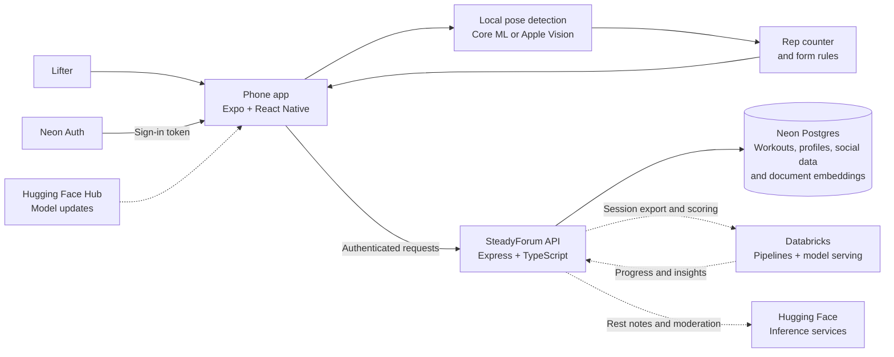
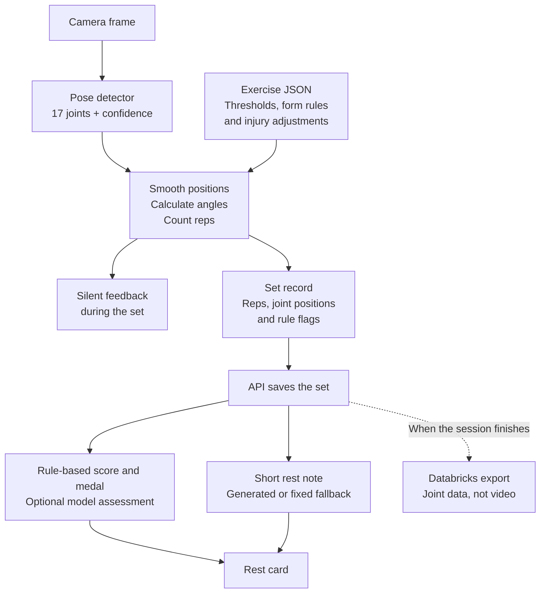
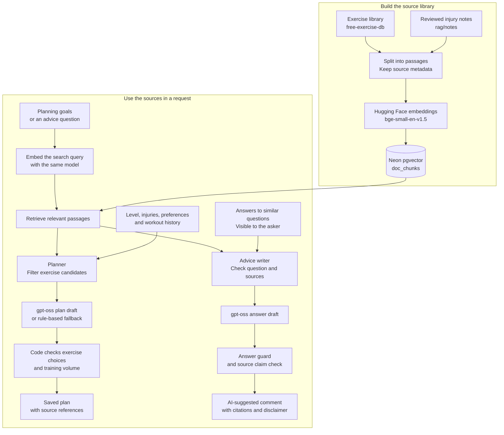
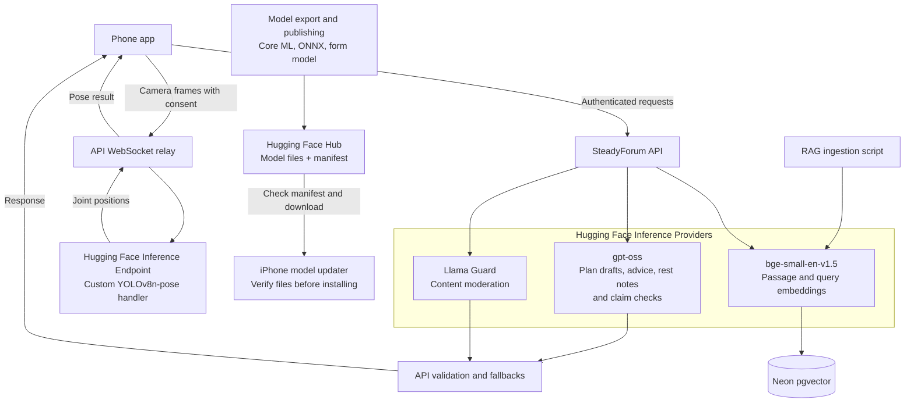

# SteadyForum

A quiet workout companion for people getting back to the gym after an injury, and for people learning how to train.

SteadyForum uses a phone camera to estimate body position, count reps, and check movement against exercise rules. The idea is to keep feedback quiet during a set, then give the lifter a short note while they rest. Progress is measured against their own recent workouts.

Built for Knight Hacks 2026.

## What we're building

Returning to exercise can mean following a physio's plan alone at home. SteadyForum's recovery workflow is designed to track that plan, including prescribed movement limits, and make progress easier to discuss at the next appointment. The same form-checking engine supports regular gym workouts.

The app has five tabs:

| Tab | Purpose |
| --- | --- |
| Train | Pick an exercise, check camera placement, and work through a session. |
| Plan | Organize workouts around goals, available equipment, and injuries. |
| Feed | Share workouts and ask the community questions. |
| Buddies | Find people with compatible training preferences. |
| Me | View workout history, progress, and account settings. |

The core exercise specs cover squats, push-ups, bicep curls, shoulder presses, and lunges. Each spec defines rep thresholds, form rules, camera views, and injury adjustments in JSON.

SteadyForum is a fitness prototype. Its recovery features track a physio's instructions; they do not diagnose injuries or prescribe treatment.

## How it fits together

The phone handles movement tracking. The API handles accounts and workout records. Databricks processes session data for progress and model development, while Hugging Face hosts models and provides language inference.



Dashed connections depend on configured external services. The API can use the phone's rule score and fixed rest notes when scoring or language services are unavailable.

Neon stores the app's operational data. The Databricks pipeline turns exported sessions into bronze, silver, and gold tables: raw records, validated sets and reps, then progress summaries and training datasets. The API syncs available insights back into Neon so the app can read them.

## From a camera frame to a rest note

The pose model returns 17 joints with confidence scores. The form engine smooths those positions, calculates joint angles, and tracks the movement through a rep state machine. Exercise rules turn detected problems into named flags, such as insufficient depth or a fast lowering phase.



Rules decide whether a rep counts as clean and determine the medal. A model assessment can add information, but it does not override the rule flags. Medals compare the lifter's form score with their own recent baseline.

The diagrams describe the system architecture. The app supports camera tracking and manual logging; some screens still use sample data or await backend integration.

## RAG pipeline

Retrieval-augmented generation (RAG) gives the planner and advice writer source material before they ask a model to draft anything. The ingestion script splits the exercise library and reviewed injury notes into passages, embeds them with `BAAI/bge-small-en-v1.5`, and stores the text, metadata, and 384-dimensional vectors in Neon's `doc_chunks` table. It re-embeds passages when their content changes.



The planner filters exercise candidates for the user's injuries and checks the draft in code. Advice retrieval can also use members' answers to similar questions, while excluding earlier AI answers and blocked users. Questions mentioning pain or acute warning signs get a fixed reply before the advice model runs. If an answer fails its checks, the thread stays open for community answers without an AI reply.

See [`rag/ingest.ts`](rag/ingest.ts), the [planner](apps/api/src/services/planner.ts), and the [advice retrieval service](apps/api/src/services/adviceThread.ts) for the implementation.

## Hugging Face integration

Hugging Face has three roles in the project: inference providers run language and embedding models, a custom endpoint runs cloud pose detection, and the Hub distributes model files. The phone calls the API for hosted inference; the API keeps the inference token on the server.



The language client tries its configured model/provider chain within a deadline. Rest notes fall back to fixed text, and the planner can produce a rule-based plan when inference fails. Moderation combines Llama Guard with a separate threats and harassment check using the language model.

Model publishing uploads exported artifacts and a manifest to the Hub. The iPhone updater downloads changed files and verifies them before installation. The native detector currently loads bundled models, so downloading an update does not yet switch the running pose model.

See the [language client](apps/api/src/integrations/huggingface/llm.ts), [cloud endpoint guide](ml/cloud_endpoint/README.md), and [model publishing guide](ml/pose_export/README.md#publish-to-the-hugging-face-hub-conn-10) for setup details.

## Camera data and privacy

On-device mode runs YOLOv8n-pose through Core ML on an iPhone. Apple Vision body pose is also available as a manual choice. In these modes, camera frames stay on the phone; workout uploads contain joint positions and rep data.

Cloud pose mode is a separate path for devices that cannot run the model locally. It requires consent to send camera frames through the API to a Hugging Face endpoint. The relay and endpoint process frames in memory without saving them. The server keeps the Hugging Face token.

The mobile app checks whether the cloud relay is reachable before selecting cloud mode. This path needs a configured endpoint and network access. See the [cloud endpoint guide](ml/cloud_endpoint/README.md) for the protocol and deployment details.

## Project status

This repository is under active development. It contains the native iOS pose plugin, rep and form engines, shared exercise and set-record contracts, the session and social API, and Databricks pipelines. The mobile app includes authentication, onboarding, camera-tracked and manual workouts, rest cards, account sync, and a pose debug screen.

The API includes physio plans, range-of-motion reports, back-to-gym milestones, advice threads, and workout plan generation. Generated answers and plans depend on configured inference services. The Train screen uses a sample routine, and buddy matching is not connected to the mobile screen yet. [Architecture.md](Architecture.md) describes the product and its recovery workflow in detail.

## Run it locally

Use Node.js 22.13 or newer. The mobile package pins pnpm 11.25.0; the API uses npm. Native camera testing also needs a Mac with Xcode, CocoaPods, uv, and an iPhone running iOS 17 or newer.

### App preview

From the repository root:

```sh
cd apps/mobile
pnpm install --frozen-lockfile
cp .env.example .env
pnpm web
```

Set `EXPO_PUBLIC_NEON_AUTH_URL` and `EXPO_PUBLIC_API_URL` in the mobile `.env` to connect authentication and the backend. The web preview lets you explore the screens; use a native development build to test the iOS pose plugin.

### Backend

In a separate terminal, from the repository root:

```sh
cd apps/api
npm install
cp .env.example .env
```

Fill in `DATABASE_URL` for your development Neon branch and `NEON_AUTH_JWKS_URL` for token verification. Configure optional service credentials for your environment, then run:

```sh
npm run db:migrate
npm run db:load-specs
npm run dev
```

The API listens on port 3000 by default. `GET /health` checks that it is running; `GET /health/ready` also checks the database. A physical phone needs an API URL it can reach, such as your development machine's LAN address.

### Camera testing on an iPhone

Export the models from the repository root before generating the native app:

```sh
cd ml/pose_export
uv run export.py
cd ../../apps/mobile
pnpm exec expo prebuild -p ios
pnpm ios:device
```

Configure your signing team in Xcode before installing on a phone. The app needs a development build because the pose plugin uses native code. Follow the [mobile guide](apps/mobile/README.md) for signing and troubleshooting, and the [model export guide](ml/pose_export/README.md) for model setup.

## Repository map

| Path | What's there |
| --- | --- |
| [`apps/mobile/`](apps/mobile/) | Expo app, screens, local form engine, and native pose plugin. |
| [`apps/api/`](apps/api/) | Express API, Drizzle schema and migrations, service integrations, and tests. |
| [`specs/`](specs/) | Exercise definitions and the shared set-record schema and fixtures. |
| [`ml/pose_export/`](ml/pose_export/) | Core ML export, model publishing, and the PoseBench iPhone benchmark app. |
| [`ml/cloud_endpoint/`](ml/cloud_endpoint/) | Hugging Face handler for cloud pose inference. |
| [`ml/labelling/`](ml/labelling/) | Joint-sequence capture, annotation, validation, and dataset export tooling. |
| [`databricks/`](databricks/) | Session pipelines, setup SQL, and notebooks. |
| [`rag/`](rag/) | Exercise-library and reviewed injury-note ingestion into pgvector. |
| [`docs/`](docs/) | Pose details, shared contracts, and operational runbooks. |
| [`Markdown/`](Markdown/) | Implementation notes and design records. |

## Checks

Run these from the repository root in separate terminals, or return to the root between blocks:

```sh
cd apps/mobile
pnpm lint
pnpm typecheck
pnpm test
```

```sh
cd apps/api
npm run lint
npm run typecheck
npm test
```

The API tests apply the migrations to an in-memory PGlite database with pgvector, so they do not require a live Neon database. To check the shared exercise and set-record definitions from the repository root:

```sh
node specs/validate.mjs
node --test specs/*.test.mjs
```

For more detail, start with the [architecture](Architecture.md), [pose processing guide](docs/pose/how-it-works.md), [set-record contract](docs/specs/set-record-format.md), or [session round-trip runbook](docs/runbooks/session-roundtrip.md).
